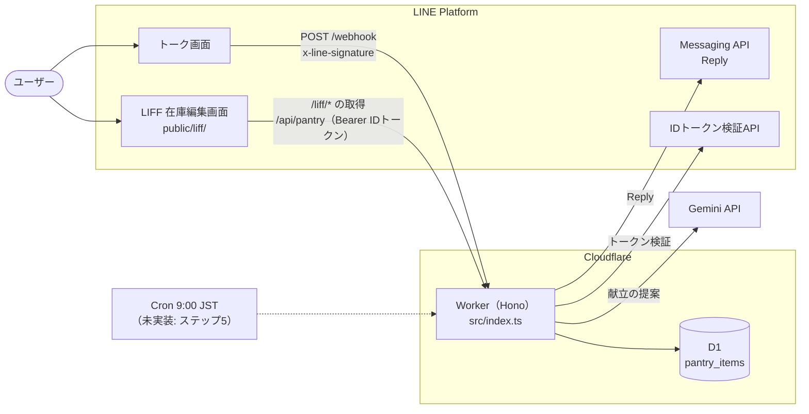
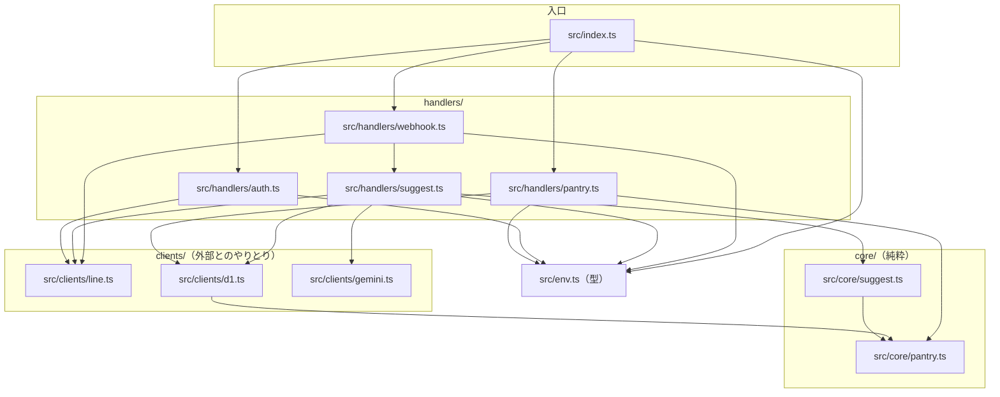
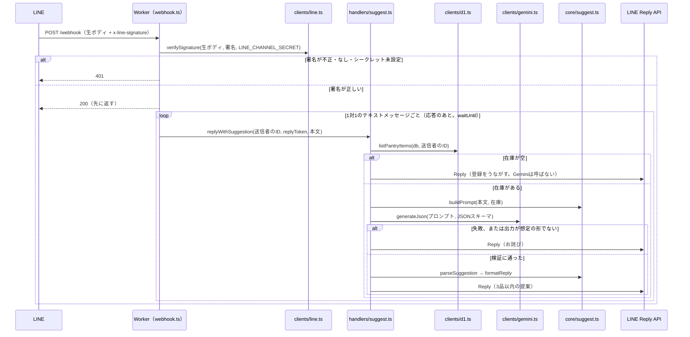
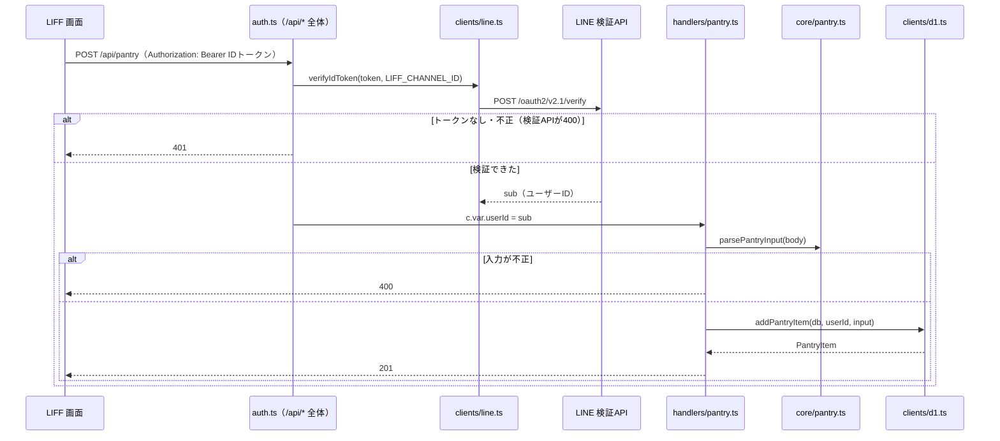
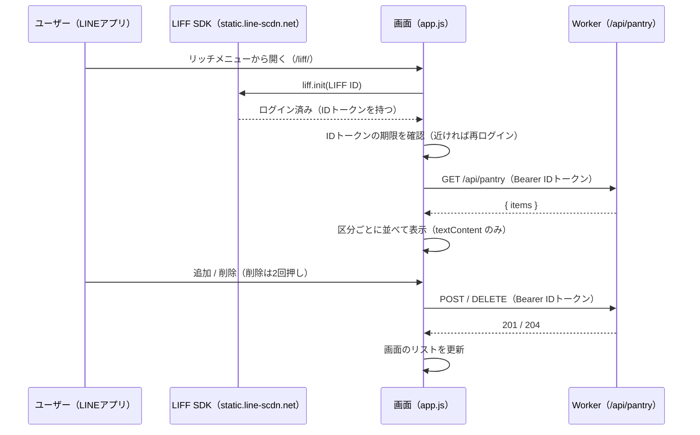
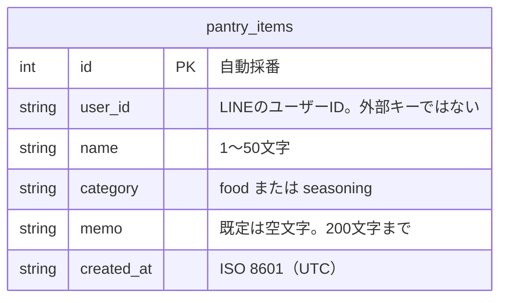

# 設計書

最終確認: 2026-11-24（ステップ4の実装時点。Gemini は本物のAPIでの確認と、本番へのデプロイが未了）

この文書は、実装の現状を表す。計画ではない。未実装のものは「未実装」と明記する。
更新のしかたは [CLAUDE.md](../CLAUDE.md) の「ステップ完了時」に従う。
`pnpm run check:docs` が、ファイル一覧・モジュール依存図・ER図の3つを実物と突き合わせる。

## 1. 全体構成

## 2. モジュール依存

矢印は「import する側 → import される側」。`src/` の相対 import だけを描く（外部パッケージの `hono` と `zod` は描かない）。

層のルール:

- `core/` は何も import しない（純粋な関数と型）
- 外部APIの呼び出しは `clients/` だけ
- `handlers/` が `clients/` と `core/` をつなぐ
- `index.ts` はルート定義だけで、処理は書かない

## 3. リクエストの流れ

### 3.1 POST /webhook（献立の提案）

- 扱うのは、1対1のトークのテキストだけ。グループ・ルームの発言、スタンプなどは無視する
- ユーザーIDは、署名検証を通ったイベントの `source.userId`。本文には含まれない
- Geminiは数秒かかるので、LINEには先に200を返し、残りは応答のあとで行う。イベントごとに独立していて、1件の失敗が他を止めない
- Geminiの出力は、zod（`zod/mini`）で検証してから使う。通らなければ、そのまま送らずにお詫びを返す
- 失敗はログに出す（`wrangler tail` で見られる）。ユーザーには定型のお詫びだけを返す

### 3.2 POST /api/pantry（在庫の追加）

LINEの障害で検証できなかったときは、`verifyIdToken` が例外を投げ、500になる。

### 3.3 LIFF画面（在庫の表示・追加・削除）

画面は `public/liff/` の静的ファイル。Workerのコードは通らず、Cloudflareの静的アセット機能が直接返す。

- ユーザーIDは画面からは送らない。送るのはIDトークンだけで、サーバーが検証して取り出す
- IDトークンの期限は約1時間。期限が近いと `liff.logout()` と `liff.login()` でログインし直す。それでも取れないときは、繰り返さずエラーを出す（LIFFの Scope に `openid` が無い場合）

### 3.4 リッチメニュー（コードの外）

トーク画面下のメニューは、LINE Official Account Manager の画面で設定する（このリポジトリには入らない）。ボタンのリンク先は `https://liff.line.me/<LIFF ID>`。

## 4. データモデル

### 4.1 ER図

テーブルは1つだけ。ユーザーの表は持たない。`user_id` は、LIFFのIDトークンを検証して得た `sub` で、Messaging API のWebhookで届く `source.userId` と同じ値（同じプロバイダーの場合）。

### 4.2 制約と設計の理由

| 項目 | 内容 | 理由 |
| --- | --- | --- |
| `id` | `INTEGER PRIMARY KEY AUTOINCREMENT` | 画面から `DELETE /api/pantry/:id` で指すだけなので、連番で足りる |
| `category` | `CHECK (category IN ('food', 'seasoning'))` | コードの検証をすり抜けても、DBが不正値を弾く |
| `memo` | `NOT NULL DEFAULT ''` | 「メモなし」を空文字ひとつに揃え、null との二重表現を避ける |
| `created_at` | `strftime('%Y-%m-%dT%H:%M:%SZ', 'now')` | UTCのISO形式の文字列。並べ替えと表示がそのままできる |
| インデックス | `idx_pantry_items_user_id (user_id)` | 一覧・削除はすべて `user_id` で絞る |
| 持たないもの | 数量、賞味期限 | CLAUDE.md の方針。必要になったら相談してから足す |

### 4.3 アクセスの規則

- 読み書きはすべて `clients/d1.ts` を通し、**必ず `user_id` で絞る**
- 他人の在庫は、一覧に出ず、削除もできない
- 削除対象が存在しない場合と、他人の在庫の場合は区別せず、どちらも404

### 4.4 まだ決まっていないこと（実装していない）

どれもスキーマ変更になるので、該当ステップの前に相談する。

| 論点 | 状況 |
| --- | --- |
| 配信対象のユーザー一覧（ステップ5） | `pantry_items` の `DISTINCT user_id` で代用できる。ただしブロックしたユーザーにもPushして、月200通の無料枠を消費する恐れがある。`users` テーブル（user_id、友だち追加日時、ブロック日時など）を作る案がある |
| 同名の在庫の重複 | いまは許す。`UNIQUE (user_id, name)` にするかは未決 |
| 利用回数の制限 | いまは無い。友だち追加した誰でもGeminiを呼べる。必要なら、1人あたりの回数をD1に持つ（表が増える） |

## 5. API仕様

認証がある経路では、検証したユーザーIDだけを使う。ボディとクエリのユーザーIDは読まない。

| メソッド | パス | 認証 | 入力 | 成功 | 失敗 |
| --- | --- | --- | --- | --- | --- |
| GET | `/liff/*` | なし | なし | 200 静的ファイル（`/liff` は307で `/liff/` へ） | 404 |
| POST | `/webhook` | `x-line-signature` | LINEのWebhookボディ | 200 | 401 署名不正 |
| GET | `/api/pantry` | `Authorization: Bearer <IDトークン>` | なし | 200 `{ items: PantryItem[] }` | 401 |
| POST | `/api/pantry` | 同上 | `{ name, category, memo? }` | 201 `{ item: PantryItem }` | 400 入力不正、401 |
| DELETE | `/api/pantry/:id` | 同上 | `:id` は正の整数 | 204 | 400 IDが不正、404 見つからない（他人の分を含む）、401 |

- `/api/*` 配下はどのパスでも、認証ミドルウェアを先に通る。存在しないパスも、トークンなしなら401
- 認証できなかったとき（LINEの障害など）は500
- `PantryItem` は `{ id: number, name: string, category: "food" | "seasoning", memo: string, createdAt: string }`

## 6. 環境変数とバインディング

| 名前 | 種類 | 用途 |
| --- | --- | --- |
| `LINE_CHANNEL_SECRET` | 秘密 | Webhookの署名検証 |
| `LINE_CHANNEL_ACCESS_TOKEN` | 秘密 | Reply API の認証 |
| `GEMINI_API_KEY` | 秘密 | Gemini APIの認証（ヘッダ `x-goog-api-key` で送る） |
| `GEMINI_MODEL` | 設定値 | 使うモデルID（いまは `gemini-3.8-flash`）。コードには書かず、`wrangler.jsonc` の `vars` に置く。変えたら再デプロイ |
| `LIFF_CHANNEL_ID` | 設定値 | IDトークンの検証で、audience として使う（LIFFを載せたLINEログインチャネルのID）。秘密ではないので `wrangler.jsonc` の `vars` に置く |
| LIFF ID（環境変数ではない） | 公開される値 | `public/liff/index.html` の `<meta name="liff-id">` に置く（LIFFのURLに含まれる値。認証情報ではない） |
| `DB` | D1バインディング | `kondate-bot`（本番D1は作成済み。`wrangler.jsonc` の `database_id` に本番のIDを入れている）。バインディング名は必ず `DB` |

秘密の3つ（`LINE_CHANNEL_SECRET`、`LINE_CHANNEL_ACCESS_TOKEN`、`GEMINI_API_KEY`）は、ローカルでは `.dev.vars`（コミットしない）、本番では `wrangler secret put` で置く。見本は `.dev.vars.example`。

## 7. 外部サービスの呼び出し

| 呼び出し | 場所 | 使うタイミング |
| --- | --- | --- |
| LINE Reply API | `clients/line.ts` の `replyMessage` | チャットへの返答 |
| LINE IDトークン検証API | `clients/line.ts` の `verifyIdToken` | `/api/*` の認証 |
| Gemini API（`generateContent`） | `clients/gemini.ts` の `generateJson` | 献立の提案。JSONスキーマを指定して、JSONで受ける |

すべて `clients/` の中だけ。テストでは必ずモックする。Push API は、ステップ5の毎朝の提案だけに使う予定（未実装）。

## 8. テスト構成

| ファイル | 対象 | 方針 |
| --- | --- | --- |
| `test/core-pantry.test.ts` | 入力検証 | 純粋関数。境界値を確かめる |
| `test/d1.test.ts` | D1ラッパー | 本物のローカルD1。ユーザーで絞れていることを確かめる |
| `test/line.test.ts` | 署名検証、Reply、IDトークン検証 | `fetch` をスタブする |
| `test/core-suggest.test.ts` | 出力スキーマ、プロンプト、返信の整形 | 純粋関数。形が違う出力を弾くこと、利用者の文字から区切りを除くことを確かめる |
| `test/gemini.test.ts` | Geminiクライアント | `fetch` をスタブする。リクエストの形、キーがURLに入らないこと、使えない応答を例外にすることを確かめる |
| `test/webhook.test.ts` | `/webhook` 全体（提案の流れ） | `replyMessage` と `generateJson` をモック。署名検証とD1は本物。「先に200を返す」「他人の在庫を使わない」「在庫が空ならGeminiを呼ばない」などを確かめる |
| `test/pantry-api.test.ts` | `/api/pantry` 全体 | `verifyIdToken` をモック、D1は本物。ボディやクエリのユーザーIDを信用しないことを確かめる |
| `test/liff-view.test.ts` | 画面の表示ロジック（`pantry-view.js`） | 純粋関数。区分ごとの分け方を確かめる |
| `test/liff-screen.test.ts` | 画面ファイルの中身 | `?raw` で読んだ文字列を検査する（フォームの有無、LIFF IDの形式、入力上限がAPIと同じ、HTML差し込みAPIを使わない、ユーザーIDを送らない） |

共通の決まり:

- DBを使うテストは、`beforeEach` で `resetDb()` を呼ぶ（スキーマ適用と全削除）
- `blockNetwork()` で、テスト中の外部通信を失敗させる。モックが効かなくなっても、本物のLINEを叩かない
- 静的アセットの配信はテストできない（テスト環境の `SELF` は静的アセットを返さない）。`wrangler dev` で確かめる
- 画面の動作（表示・追加・削除）は、LIFFと `fetch` をモックしたページをヘッドレスChromeで動かして確かめた（リポジトリには入れていない）
- `setupFiles` は使わない。`cloudflare:test` を先に読み込むと、Worker本体が本物の clients をキャッシュし、`vi.mock` が効かなくなる

## 9. 守っている不変条件

| 不変条件 | 守っている場所 |
| --- | --- |
| Webhookは署名検証を必ず行う | `handlers/webhook.ts`（JSONを読む前に検証） |
| `/api/*` はトークン検証を必ず通る | `index.ts` の `app.use("/api/*", ...)` |
| ユーザーIDは検証結果だけを使う | `handlers/pantry.ts` は `c.var.userId` のみを読む |
| 他人の在庫に触れない | `clients/d1.ts` の全クエリが `user_id` で絞る |
| 外部APIは `clients/` だけが呼ぶ | 層のルール（第2章）。`core/` は何も import しない |
| 画面は、利用者が入れた文字をそのまま文字として出す | `public/liff/app.js` は `textContent` だけを使う（`test/liff-screen.test.ts` が、HTML差し込みAPIの使用を検出する） |
| 画面はユーザーIDを送らない | `app.js` は `Authorization` ヘッダだけを送る（同テストが検出する） |
| Geminiの出力は検証してから使う | `handlers/suggest.ts` は、`parseSuggestion`（zod）を通ったものだけを整形する |
| 利用者の文字は、区切りを偽装できない形でプロンプトに入れる | `core/suggest.ts` が `< >` と改行を除き、希望は200文字、在庫は100件で切る |
| Geminiの呼び出しは `clients/` だけ | `clients/gemini.ts`（`handlers/` と `core/` は `fetch` を使わない） |
| チャットへの返答は Reply API | `handlers/suggest.ts` は `replyMessage` のみ。Push API は未使用 |

## 10. ファイル一覧

`src/`、`test/`、`scripts/`、`migrations/`、`public/` の全ファイルを載せる。`pnpm run check:docs` が、ここと実物の差を見つける。

| ファイル | 役割 | 追加したステップ |
| --- | --- | --- |
| `src/index.ts` | Honoのルート定義。認証ミドルウェアの適用 | 1 |
| `src/env.ts` | 環境変数とバインディングの型、リクエスト単位の変数の型 | 1 |
| `src/handlers/webhook.ts` | 署名検証と、イベントの振り分け（1対1のテキストだけを提案に回す） | 1（4で提案に置き換え） |
| `src/handlers/suggest.ts` | 在庫の取得、Gemini、検証、Replyまでの流れ | 4 |
| `src/handlers/auth.ts` | `/api/*` のトークン検証ミドルウェア | 2 |
| `src/handlers/pantry.ts` | 在庫API（GET / POST / DELETE） | 2 |
| `src/clients/line.ts` | 署名検証、Reply API、IDトークン検証 | 1 |
| `src/clients/d1.ts` | 在庫のD1操作（一覧・追加・削除） | 2 |
| `src/clients/gemini.ts` | Gemini API を呼ぶ（JSONで受ける） | 4 |
| `src/core/pantry.ts` | 在庫の型、カテゴリ、入力検証 | 2 |
| `src/core/suggest.ts` | 提案の出力スキーマ（zod）、プロンプト、返信の整形、定型文 | 4 |
| `migrations/0001_create_pantry_items.sql` | `pantry_items` の作成 | 2 |
| `public/liff/index.html` | 在庫編集画面の骨組み。LIFF IDを持つ | 3 |
| `public/liff/app.js` | 画面の動作（LIFF初期化、一覧・追加・削除） | 3 |
| `public/liff/pantry-view.js` | 画面の表示ロジック（区分ごとの分け方）。DOMに触れない | 3 |
| `public/liff/style.css` | 画面のスタイル（ライト・ダーク対応） | 3 |
| `scripts/simulate.ts` | 擬似Webhookを送る | 2 |
| `scripts/try-gemini.ts` | 本物のGemini APIを1回呼んで、検証まで通るか確かめる（人間が実行） | 4 |
| `scripts/check-docs.ts` | この設計書と実物の突き合わせ | 2 |
| `scripts/node-shims.d.ts` | `@types/node` を入れていないための、最小の型宣言 | 2 |
| `test/helpers.ts` | 署名の生成、DB初期化、外部通信ガード | 1 |
| `test/env.d.ts` | テスト用バインディングの型 | 2 |
| `test/line.test.ts` | LINEクライアントのテスト | 1 |
| `test/webhook.test.ts` | Webhookのテスト | 1 |
| `test/core-pantry.test.ts` | 入力検証のテスト | 2 |
| `test/core-suggest.test.ts` | 提案の純粋関数のテスト | 4 |
| `test/gemini.test.ts` | Geminiクライアントのテスト | 4 |
| `test/d1.test.ts` | D1ラッパーのテスト | 2 |
| `test/pantry-api.test.ts` | 在庫APIのテスト | 2 |
| `test/liff-view.test.ts` | 画面の表示ロジックのテスト | 3 |
| `test/liff-screen.test.ts` | 画面ファイルの中身の検査 | 3 |
| `test/raw.d.ts` | `?raw` import の型 | 3 |

設定ファイル（一覧の突き合わせの対象外）: `package.json`、`wrangler.jsonc`、`tsconfig.json`、`vitest.config.ts`、`biome.json`、`.gitignore`、`.dev.vars.example`。

## 11. 今後のステップで増えるもの（未実装）

| ステップ | 増えるもの |
| --- | --- |
| 5 | `scheduled`（cron 9:00 JST）、Push API の呼び出し。提案の流れ（`handlers/suggest.ts` の `suggestionText`）を再利用する |
